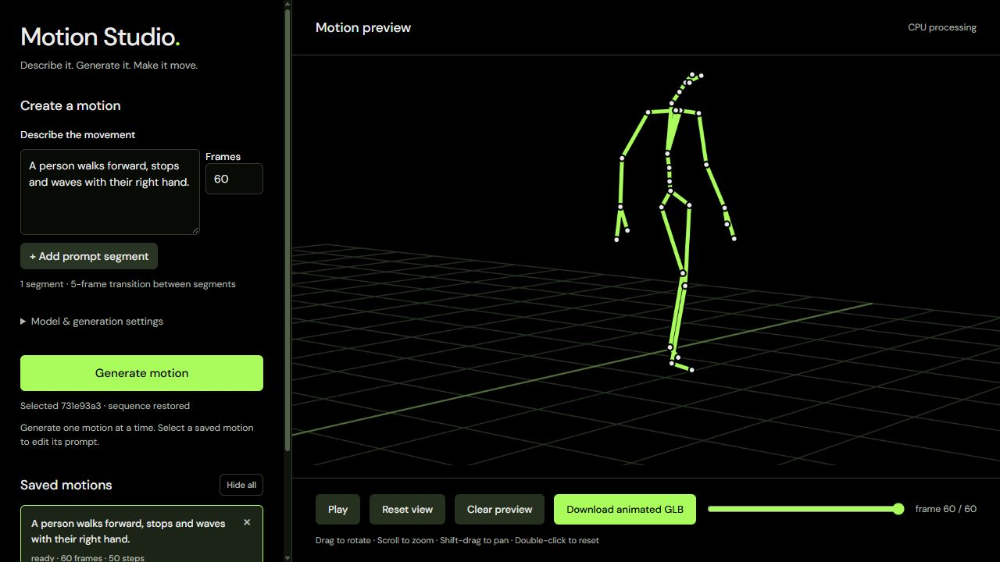
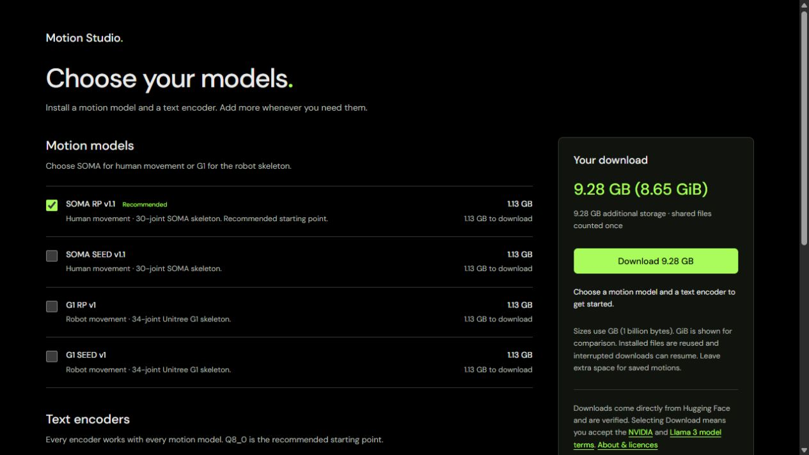

# Motion Studio

Describe a movement, generate it locally and export an animated GLB.
Motion Studio runs NVIDIA Kimodo through kimodo.cpp on Windows 11 x64,
using your CPU or a Vulkan graphics card.

**[Download Motion Studio 1.1.0 for Windows](https://github.com/ZURAVFX/Motion-Studio/releases/download/v1.1.0/Motion-Studio-Setup-1.1.0.exe)**

Installer: 14.6 MB. Model weights download separately; sizes are shown before
you start. The installer includes the runtimes, so you do not need build tools,
Python, Go or the Vulkan SDK. The installer is unsigned.

## Choose your models

Download any of the four SOMA/G1 motion models and six text encoders.
Each option shows its size. The download summary accounts for files already
installed, partial downloads and shared files, so you can see the remaining
total before starting. Interrupted downloads can resume.

| Motion model | Skeleton | Download |
|---|---|---:|
| SOMA RP v1.1 | 30-joint human | 1.13 GB |
| SOMA SEED v1.1 | 30-joint human | 1.13 GB |
| G1 RP v1 | 34-joint robot | 1.13 GB |
| G1 SEED v1 | 34-joint robot | 1.13 GB |

| Text encoder | Download including shared tokenizer |
|---|---:|
| Q8_0 (recommended) | 8.15 GB |
| Q6_K | 6.33 GB |
| Q5_K | 5.34 GB |
| Q4_K | 4.40 GB |
| Q4_K_M | 5.07 GB |
| BF16 reference | 15.18 GB |

Any encoder works with any motion model. Smaller quantisations can change the
results; Q4_K has substantial measured divergence from the BF16 reference in
upstream comparisons. SOMA RP + Q8_0 is the recommended starting pair:
**9.28 GB (8.65 GiB)** for a fresh setup. Allow at least 12 GB free space.

SMPL-X RP v1 is supported through a **local GGUF import** for separately
licensed non-commercial research. Obtain access to the checkpoint and convert
it using upstream tools. Its weights are not automatically downloaded or
included. The engine validates the imported checkpoint when used.

## Use it

1. Run the installer and open Motion Studio.
2. Choose a motion model and text encoder in the model library, then download.
3. Describe a movement, choose frames/settings and select Generate motion.
4. Select the saved result to preview it and Download animated GLB.

Use the **×** on a motion to hide it, **Hide all** to tidy the list, or
**Clear preview** to empty the viewport. **Restore hidden motions** brings
the list back. These controls keep the saved files, and clearing preserves
your prompt and settings. Visibility preferences survive browser reloads.

The exported GLB contains animated skeleton nodes without a character mesh.
Retargeting/rigging is done in your animation software. Fine finger animation
and the expanded SOMA presentation skeleton are not included.

The launcher chooses Vulkan when available. If your GPU fails, quit from the
tray icon and use the CPU mode shortcut. Windows 11 x64 with AVX2 is required;
ARM Windows is not supported. 16 GB RAM or more is recommended for Q8_0,
with more needed for BF16. Hardware and settings affect performance.

Generation stays on your computer and works offline after model installation.
Downloads contact Hugging Face. Updates preserve installed models and saved
motions. See the [team/user guide](docs/Motion-Studio-Team-Guide.txt).

## Distribution and credits

This repository provides **binary downloads and documentation**. Application
source is maintained privately and is not published here. GitHub's automatic
repository archives contain only this distribution documentation.

Motion Studio is a modified distribution of the
[Apache-2.0 kimodo.cpp engine](https://github.com/localai-org/kimodo.cpp),
[GGML](https://github.com/ggml-org/ggml) and NVIDIA Kimodo.
**Built with Meta Llama 3.**

SOMA/G1 models have [NVIDIA Open Model terms](https://www.nvidia.com/en-us/agreements/enterprise-software/nvidia-open-model-license/).
The [text encoder has separate Meta Llama 3 terms](https://huggingface.co/LocalAI-io/Llama-3-Kimodo-GGML).
SMPL-X has separate research restrictions. Full third-party notices are in
the installer and [THIRD-PARTY-NOTICES](THIRD-PARTY-NOTICES/).
No model weights are bundled in the installer.
